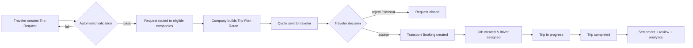
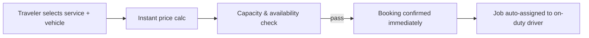
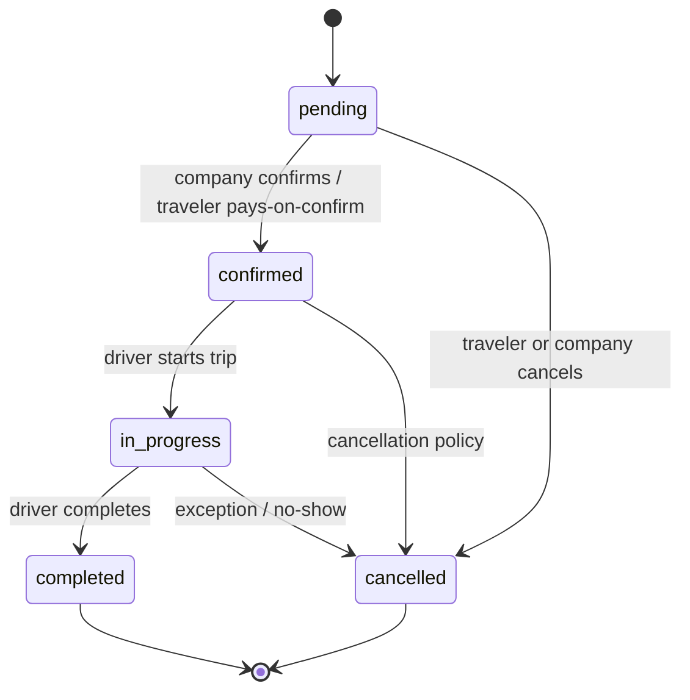

# Trip & Booking Workflow — Professional Operating Model

**Scope:** Tour transport platform (cars/vans/buses): trip requests, trip plans, transport bookings, rentals, jobs, and route ("flight") plans.
**Audience:** Product, engineering, operations, company partners, drivers.
**Status:** Proposed professional workflow (design specification). Aligns with `docs/IMPLEMENTATION-PLAN-TRANSPORT.md`.

---

## 0. Core rule: every booking is a trip

A booking is **never** a standalone record. Creating a booking **always** creates (or links) a **Trip** carrying an **origin** and a **destination** (plus waypoints, distance, duration, ETA). There is no "normal booking" path.

- `TripRequest` captures the traveler's origin/destination intent.
- `TripPlan` is the company's concrete proposal over that route.
- `TransportBooking` is the committed agreement and **must reference a TripPlan (or at minimum store origin/destination + route)**.
- `Job` and `RoutePlan` derive from the same trip; all parties see one origin→destination journey.

If a traveler tries to book without origin/destination, the request is rejected at the gate (400) — no booking row is created.

## 1. Design principles

1. **One source of truth per entity.** A `TripPlan` is the single proposal; a `TransportBooking` is the single committed agreement. No parallel "quote" copies.
2. **Server-derived attribution.** Company, price, and tour/vehicle title are derived from server-loaded records inside a transactional lock. Client values are never trusted for scope, pricing, or capacity.
3. **Explicit, one-way state machines.** Every status transition is declared in a whitelist table. Terminal states (`cancelled`, `completed`, `expired`) are irreversible.
4. **Straight-through processing (STP).** A request that passes all automated gates (capacity, availability, price, validation) is confirmed without human intervention. Humans intervene only on exceptions.
5. **Fail closed, recover gracefully.** Notifications, analytics, and non-critical side effects run *after* commit and are caught/logged so they never roll back a valid booking.
6. **Concurrency by design.** Capacity and availability are checked and mutated under row-level locks (`SELECT ... FOR UPDATE`) inside a single transaction.
7. **Audit everything privileged.** Every state change records actor, company, before/after, IP, and user agent.
8. **Company-scoped collaboration.** All reads/writes are scoped to the server-resolved active company membership. Cross-company access returns 404/403 without leaking existence.

---

## 2. Roles and responsibilities

| Role | Owns | May not |
|---|---|---|
| **Traveler (Customer)** | Create trip request, accept quote, view own bookings, cancel pending, rate trip | Edit confirmed bookings, see other companies' data, set company/price |
| **Company Owner** | Company profile, fleet, staff, pricing, analytics, all bookings | Platform admin powers, other companies |
| **Company Manager** | Tours/services, trip plans, bookings, analytics | Membership management, platform fields |
| **Company Staff** | Read/update bookings per policy, view dashboard | Profile/tour/member edits |
| **Driver (Private)** | Accept assigned jobs, start/complete, update location | Browse public jobs unless shared |
| **Driver (Public)** | Browse/accept public jobs, complete, earn | See private jobs, edit company data |
| **Platform Admin** | Approve companies/drivers, oversight, analytics | Bypass audit; never edits company data silently |
| **System (Automation)** | Capacity, availability, pricing, routing, notifications, SLA timers | — |

Permission matrix (abbreviated):

| Action | Owner | Manager | Staff | Driver | Traveler |
|---|---|---|---|---|---|
| Create/edit vehicle | ✅ | ✅ | ❌ | ❌ | ❌ |
| Create trip plan / quote | ✅ | ✅ | ❌ | ❌ | ❌ |
| Confirm/cancel booking | ✅ | ✅ | ✅ (policy) | ❌ | cancel pending only |
| Post/share job | ✅ | ✅ | ❌ | ❌ | ❌ |
| Accept/start/complete job | ❌ | ❌ | ❌ | ✅ | ❌ |
| View company analytics | ✅ | ✅ | ❌ | ❌ | ❌ |
| Manage memberships | ✅ | ❌ | ❌ | ❌ | ❌ |

---

## 3. End-to-end process map (trip-first)

> **Every booking starts as a trip.** There is no booking without an origin and a destination. The intake step below is mandatory and cannot be skipped or bypassed by STP.




### 3.0 Booking creation contract (trip-first)

When a booking is created, the server **must** persist a trip:

1. Read/validate `origin`, `originLat`, `originLng`, `destination`, `destLat`, `destLng` from the request.
2. If any is missing → `400 "Origin and destination are required."` — no DB write.
3. Compute `distanceKm`, `durationMins` via route service (or accept a cached route).
4. Persist `TripRequest` (if not already) + `TripPlan` (company proposal) + `TransportBooking` referencing `tripPlanId` and storing origin/dest snapshot.
5. Persist `RoutePlan` segments from the computed route.
6. Create `Job` from the trip's schedule.

Client-supplied price/company/vehicle are ignored; all derived server-side inside the lock.

### 3.1 Straight-through shortcut (STP)

For simple, fixed-price services (e.g., airport transfer with a published tariff and an available vehicle), the flow collapses:



STP is enabled only when: published price exists, vehicle available, no waypoints/custom routing, and company has an on-duty driver pool. Otherwise the request goes through the quoted flow (§3).

---

## 4. State machines

### 4.1 TripRequest

| From | To | Trigger | Gate |
|---|---|---|---|
| — | `REQUESTED` | Traveler submits | Validation (coords, date, passengers) |
| `REQUESTED` | `QUOTED` | Company sends TripPlan | Company active; vehicle available |
| `REQUESTED` | `CANCELLED` | Traveler cancels | Before quote accepted |
| `QUOTED` | `ACCEPTED` | Traveler accepts a quote | Price/capacity re-check |
| `QUOTED` | `EXPIRED` | SLA timeout (e.g., 48h) | System timer |
| `QUOTED` | `CANCELLED` | Traveler rejects | — |
| `ACCEPTED` | `COMPLETED` | Trip finished | Booking completed |
| `ACCEPTED` | `CANCELLED` | Cancellation policy | Refund/penalty rules |

### 4.2 TransportBooking



Transition whitelist (enforced server-side):

| Current | Allowed next |
|---|---|
| `pending` | `confirmed`, `cancelled` |
| `confirmed` | `in_progress`, `cancelled` |
| `in_progress` | `completed`, `cancelled` |
| `completed` | (terminal) |
| `cancelled` | (terminal) |

### 4.3 Job (driver work)

| From | To | Trigger |
|---|---|---|
| — | `OPEN` | Created from booking/plan (or shared) |
| `OPEN` | `ASSIGNED` | Driver accepts (public) or company assigns (private) |
| `OPEN` | `EXPIRED` | No acceptance within SLA |
| `OPEN` | `CANCELLED` | Booking cancelled |
| `ASSIGNED` | `IN_PROGRESS` | Driver starts |
| `ASSIGNED` | `CANCELLED` | Reassignment / cancellation |
| `IN_PROGRESS` | `COMPLETED` | Driver completes (with proof) |
| `IN_PROGRESS` | `CANCELLED` | Exception |

### 4.4 Rental

`pending → confirmed → active → completed` (or `cancelled` at any pre-active step).

---

## 5. Collaboration model ("working together")

### 5.1 Handoff contract

Every handoff between roles is a **typed event** with a payload, not a side-channel message:

| Handoff | From → To | Payload | SLA |
|---|---|---|---|
| Trip request created | System → Company inbox | request id, origin/dest, date, pax, luggage | 5 min to appear |
| Quote requested | Company → System → Traveler | TripPlan id, price, vehicle, ETA | 24 h to quote |
| Quote accepted | Traveler → System | plan id | instant |
| Booking confirmed | System → Company + Driver pool | booking id, route, schedule | instant |
| Job posted | Company → Driver pool | job id, requirements, payout | instant |
| Job accepted | Driver → System → Company | driver id, ETA to pickup | instant |
| Trip started | Driver → System → Traveler/Company | timestamp, location | instant |
| Trip completed | Driver → System → all | proof, distance, duration | instant |

### 5.2 Shared "flight plan" (route plan)

One `RoutePlan` record, referenced by `TripPlan`, `TransportBooking`, and `Job`, rendered identically to traveler, company, and driver. Contains ordered `RouteSegment`s: from, to, distance, duration, ETA, instructions. Any update (reroute) writes a new version and notifies all parties. No role edits the route directly; reroute requests go through the company.

### 5.3 Concurrency control (no double-booking)

```text
BEGIN TX
  SELECT id FROM vehicles WHERE id = $v FOR UPDATE
  SELECT id FROM drivers  WHERE id = $d FOR UPDATE (if assigned)
  re-check availability window overlap
  re-check capacity (passengers <= vehicle.capacity)
  INSERT booking
  UPDATE vehicle availability calendar
  INSERT job
COMMIT
```

- Vehicle availability is stored as time windows per vehicle; overlap check uses `start < other.end AND end > other.start`.
- Driver availability is checked the same way when a driver is pre-assigned.
- All checks happen **inside** the transaction after the lock.

### 5.4 Idempotency and retries

- Every mutating request accepts an `Idempotency-Key` header. Replays return the original result without re-executing side effects.
- Reference generation (`INF-YYYY-NNNN`) retries on unique constraint collision (max 3).
- Notifications are post-commit and idempotent by `(entity, event, recipient)`.

### 5.5 Collaboration surfaces

- **In-app inbox** per company (trip requests, quotes, bookings) with status filters and SLA badges.
- **Driver app** (or PWA) with job feed, accept/reject, navigation, status updates.
- **Traveler account** with booking timeline, route map, driver tracking (when in progress), cancellation.
- **Admin console** with company/driver approval queues, oversight, analytics.

---

## 6. Controls and gates

### 6.1 Validation gates (automated)

| Gate | Rule |
|---|---|
| Request validity | origin/dest coords in range; date ≥ today + lead time; passengers ≥ 1 and ≤ vehicle capacity; luggage fits |
| Company eligibility | status `ACTIVE`, `isPublic` where applicable, service type matches |
| Vehicle eligibility | status `AVAILABLE`, not retired/maintenance, capacity sufficient, no overlapping booking |
| Driver eligibility | status `ACTIVE`, license not expired, vehicle type qualified, within radius (public jobs) |
| Price integrity | server recomputes price from tariff + distance + duration; client price is ignored |
| Capacity (tour legacy) | aggregate under lock; `alreadyBooked + travelers ≤ maxTravelers` |
| Concurrency | row lock on tour/vehicle/driver before check+insert |

### 6.2 Approval gates (human)

| Gate | Approver | When |
|---|---|---|
| Company activation | Platform admin | On registration |
| Driver verification | Platform admin / Company owner | License + docs |
| Tour/service publication | Company (self) + optional platform review | `DRAFT → PUBLISHED` |
| High-value cancellation | Company owner | Above threshold |
| Refund exception | Platform admin | Disputed |

### 6.3 Audit and compliance

- `AuditLog` records: actor, companyId, action, entity, entityId, before/after JSON, IP, user agent, timestamp.
- `Notification` records are company-scoped where applicable.
- Soft deletes only; historical bookings are never cascaded away (`onDelete: Restrict`/`SetNull`).
- PII (phone, email) is masked in logs and analytics exports.

---

## 7. Optimization (straight + efficient)

### 7.1 Straight-through processing rules

Enable STP for a booking when **all** hold:
- Service has a published fixed price or a deterministic tariff.
- Vehicle is available for the window.
- No custom waypoints beyond origin/dest.
- Company has at least one available/on-duty driver (or driver not required).
- Traveler account is verified (email/phone).
- No fraud flags on traveler or company.

Otherwise route to quoted flow with SLA timers.

### 7.2 Parallelization

- Route calculation, vehicle availability, and driver pool lookup run in parallel (`Promise.all`) during quote building; only the final insert is serialized.
- Notifications, funnel events, and analytics are fired post-commit in parallel (`Promise.allSettled`) and never block the response.
- Search results use cached aggregates (Redis/Dragonfly, short TTL) with cache invalidation on booking.

### 7.3 Caching and performance

| Data | Cache | TTL | Invalidation |
|---|---|---|---|
| Vehicle availability windows | Redis | 60s | On booking change |
| Company public profile | CDN/Redis | 5 min | On profile edit |
| Route computation | Redis by (origin,dest,waypoints) | 1 h | On road data update |
| Search results | Redis | 30s | On inventory change |
| Session/membership | request-scoped | per request | — |

### 7.4 SLA timers and automation

| Timer | Duration | Action on expiry |
|---|---|---|
| Quote response | 24 h | Request marked `EXPIRED`, traveler notified, company penalized in metrics |
| Driver acceptance (public job) | 15 min | Job re-posted / escalated to private pool |
| Trip start (after confirmed pickup time + grace) | 15 min | Alert company + traveler; auto-cancel option |
| Completion proof submission | 1 h after arrival | Reminder; booking stays `in_progress` until proof |
| Cancellation free window | per policy (e.g., 24 h) | Auto-apply penalty after window |

### 7.5 Exception handling

| Exception | Detection | Resolution |
|---|---|---|
| Overbooking attempt | Capacity check fails | 400 with remaining count; traveler offered alternatives |
| Vehicle becomes unavailable | Availability check fails | Quote regenerated with next best vehicle |
| Driver no-show | SLA timer | Reassign from pool; company notified; penalty |
| Traveler no-show | Driver reports | Booking → `cancelled` (no-show); payout rules |
| Price mismatch | Server recompute differs | Use server price; log discrepancy |
| Concurrent edit | Conditional update count ≠ 1 | 409 "refresh and retry" |
| Notification failure | catch/log | Booking remains committed; retry via queue |

---

## 8. Notifications and communication

Reuse existing push/in-app/email/WhatsApp infra. Events:

| Event | Recipients | Channel |
|---|---|---|
| Trip request received | Company ops | In-app + push |
| Quote sent | Traveler | Email + in-app |
| Booking confirmed | Traveler, company, driver | All |
| Job posted | Eligible drivers | Push |
| Job accepted/started/completed | Company + traveler | Push + in-app |
| Trip completed | Traveler (review prompt) | Email + in-app |
| Cancellation | All parties | All |
| SLA breach | Company ops + admin | In-app + email |

---

## 9. Analytics and KPIs

Company-scoped and platform-scoped:
- Conversion: request → quote → booking → completed.
- Utilization: vehicle hours/days used vs. available.
- SLA compliance: quote response time, driver acceptance time, on-time start.
- Revenue: gross, commission, driver payouts, refunds.
- Quality: completion rate, cancellation rate, no-show rate, average rating.
- Driver performance: acceptance rate, completion rate, rating, earnings.

---

## 10. Migration from current (tour) workflow

Current state (this repo) is tour-centric: `Tour`, `TourDeparture`, `Booking` (tour). Proposed transition:

1. **Additive first.** Add transport models alongside tour models; no breaking change.
2. **Dual-run.** Keep tour endpoints working but hidden from new UI; transport flows use new models.
3. **Backfill.** `TravelVehicle → Vehicle`, `TravelDriver → Driver`, `CompanyTrip → TripPlan` where applicable.
4. **Switch UI** to transport flows; keep tours read-only.
5. **Deprecate** tour endpoints (410) after data freeze.
6. **Drop** tour tables in a later migration.

During transition, the booking workflow in §4.2 applies to both tour bookings (mapped to `confirmed/in_progress/completed/cancelled`) and transport bookings, so the UI and audit logic stay uniform.

---

## 11. Current vs. proposed (gap summary)

| Area | Current | Proposed |
|---|---|---|
| Booking states | `pending/confirmed/cancelled` | Add `in_progress/completed` for trip execution |
| Capacity check | Aggregate under tour lock | Time-window overlap under vehicle/driver lock |
| Pricing | Fixed at booking time | Server-recomputed tariff + distance + duration |
| Route | Stored fields on booking | Versioned `RoutePlan` shared by all parties |
| Driver | Not modeled (workspace only) | First-class `Driver` + `Job` market |
| Collaboration | Notifications only | Typed handoff events + shared flight plan + SLA timers |
| STP | None (all manual confirm) | Auto-confirm eligible simple services |
| Analytics | Basic funnel | Utilization, SLA, driver performance |

---

## 12. Immediate next steps

1. Approve this workflow and state machines with product/ops.
2. Implement Phase 1 migration (additive models + enums) on a branch.
3. Build company vehicle management + availability calendar first (highest leverage).
4. Implement STP for airport transfers as the first straight-through path.
5. Add SLA timers and exception handling in the notification queue.
6. Keep tour flows read-only during transition.

---

*End of document.*
